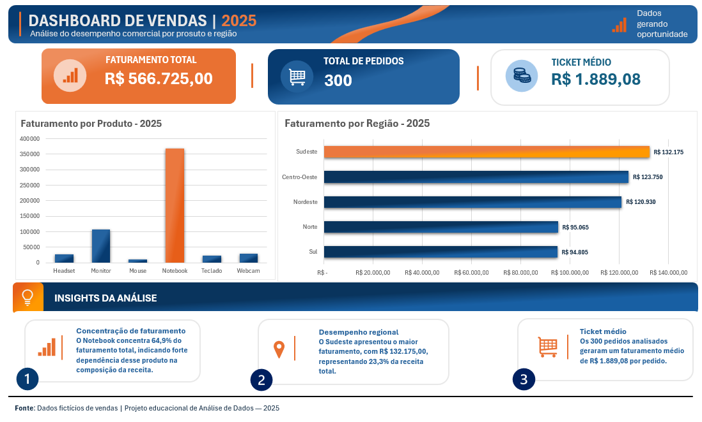

# 📊 Dashboard de Vendas | 2025

## 📌 Sobre o projeto

Este projeto apresenta uma análise exploratória de vendas desenvolvida no Microsoft Excel, utilizando uma base de dados fictícia com 300 pedidos.

O objetivo foi transformar dados comerciais em indicadores e visualizações que facilitem a compreensão do desempenho de vendas por produto e região.

## 🎯 Objetivos

- Analisar o faturamento total.
- Identificar os produtos com maior participação na receita.
- Comparar o desempenho comercial entre regiões.
- Calcular indicadores de vendas.
- Desenvolver um dashboard visual e organizado para apoiar a interpretação dos resultados.

## 🛠️ Ferramentas utilizadas

- Microsoft Excel
- Tabelas Dinâmicas
- Gráficos Dinâmicos
- Fórmulas e indicadores
- Formatação e visualização de dados

## 📈 Indicadores principais

| Indicador | Resultado |
|---|---|
| Faturamento total | R$ 566.725,00 |
| Quantidade de pedidos | 300 |
| Ticket médio | R$ 1.889,08 |

## 🔎 Principais insights

**1. Concentração de faturamento**

O produto Notebook representou aproximadamente 64,9% do faturamento total, indicando uma participação expressiva na receita.

**2. Desempenho regional**

A região Sudeste registrou R$ 132.175,00 em vendas, correspondendo a aproximadamente 23,3% do faturamento total.

**3. Análise do ticket médio**

O ticket médio de R$ 1.889,08 permite
